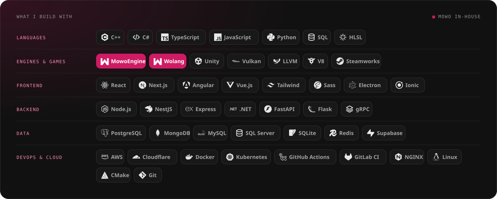
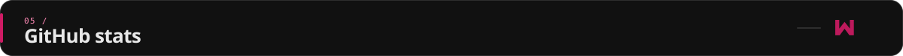
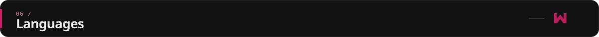

<div align="center">



<br/>

[](https://mowogames.com)
[](https://mowoengine.com)
[](https://www.linkedin.com/in/monntecc)
[](mailto:monntecc@gmail.com)
[](https://discord.com/users/monntecc)
[](https://t.me/monntecc)


</div>

<br/>


Full-stack software engineer with a strong background in **game development** and **multiplayer systems**. I like the whole stack under a game — the engine, the scripting language, the launcher, the account service and the store — and I enjoy bridging creative design and technical implementation.

```ts
const vladyslav = {
  location:   "Spain",
  focus:      ["game engines", "multiplayer platforms", "client/server architecture", "cross-platform apps"],
  building:   "Mowo Games — engine, language, launcher and games",
  dayJob:     "Majestic Games",
  speaks:     ["Russian", "Ukrainian", "Polish", "English", "Spanish"],
};
```

<br/>


<table>
<tr>
<td width="50%" valign="top">

###  [Mowo Games](https://mowogames.com)
**Independent game studio.** We make our own games, the tech they run on, and the launcher that keeps them together.

- **NULL** — in early access
- **Ultimate Durak**
- **Mowo Games Launcher** — updates, cloud saves and friends across Steam and Mowo
- **Mowo ID** — one account for every Mowo game

</td>
<td width="50%" valign="top">

###  [MowoEngine](https://mowoengine.com)
**A C++20 game engine** with its own RHI, editor, build tool and data format.

- Backend-agnostic renderer, physics, audio, online
- **Arc** UI framework and Visual Scripting
- **MowoBuildTool** — C#/.NET build system
- Windows · macOS · Linux · Android · iOS

</td>
</tr>
<tr>
<td width="50%" valign="top">

###  Wolang
**A statically typed, compiled language** for gameplay code — lexer → parser → sema → effects → typed SSA IR.

- Three tiers that agree: interpreter, JIT (x64 / arm64) and LLVM AOT
- Standard library written in Wolang itself
- Apache-2.0

</td>
<td width="50%" valign="top">

###  Web platform
The sites and services around the games.

- **mowogames.com** — store, profiles, friends
- **id.mowogames.com** — accounts, OIDC / SAML
- **mowoengine.com** — docs, blog, engine licensing
- Next.js · React · FastAPI · PostgreSQL · Redis

</td>
</tr>
</table>

<div align="center">

[](https://mowogames.com)
[](https://mowoengine.com)
[](https://github.com/MowoGames)

</div>

<br/>


| | Company | Role | When |
|:-:|---|---|---|
|  | **[Mowo Games](https://mowogames.com)** | Founder & Lead Engineer — engine, language, launcher, web platform | 2025 — Present |
|  | **Majestic Games Limited** | Software Engineer | Jan 2025 — Present |
|  | **alt:V Multiplayer** | C++ Developer | Jan 2025 — Aug 2025 |
|  | **IDO Cloud** | Full-Stack Engineer | Jan 2023 — Jan 2025 |

<details>
<summary><b>What I did there</b></summary>
<br/>

 **Majestic Games — Software Engineer**
- Developing multiplayer solutions and API modules
- Building desktop applications with Electron
- Optimizing native JS modules (N-API, V8)
- Implementing automation scripts and CI/CD workflows

 **alt:V Multiplayer — C++ Developer**
- Worked on core modules of the multiplayer platform using C++/V8
- Developed client/server libraries
- Configured CI/CD workflows

 **IDO Cloud — Full-Stack Engineer**
- Developed internal tools with Angular/Vue and NestJS
- Built cross-platform apps with Ionic Framework
- Managed AWS infrastructure
- Configured gRPC connections with Linux-based daemons

</details>

<br/>




<br/>



<div align="center">


</div>

<br/>





<br/>


<div align="center">

[](https://www.linkedin.com/in/monntecc)
[](mailto:monntecc@gmail.com)
[](https://discord.com/users/monntecc)
[](https://t.me/monntecc)
[](https://instagram.com/monntecc)

<br/><br/>


</div>
